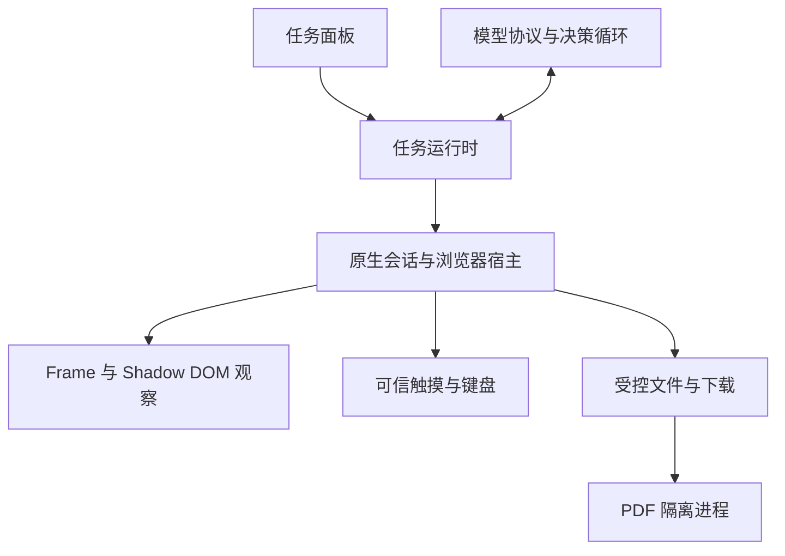

# Browser Agent：能力、交互与交付边界

## 1. 本轮交付

本轮以 beta `645f9736113660395e7392a1a119f22212f7b55d` 为基线，扩展 Android 内置 WebView 的 Browser Agent。实现涵盖多框架观察、Shadow DOM、原生触摸、文件流程、人工接管及执行结果管理。阅读、订阅、账户同步仍使用既有架构；Agent 不要求新增服务器，也不引入第二套浏览器内核。

设计目标是让 Agent 能连续完成真实任务，并在页面变化、用户操作或执行失败时保持正确的控制权。不能用“工具已调用”替代网站结果，也不能把任何网站、任何验证流程均可无人操作作为验收结论。

### 基线问题与实现

| 基线缺口 | 本轮实现 | 明确边界 |
| --- | --- | --- |
| 主文档元素列表无法可靠处理嵌套页面 | document-start frame bridge；每个 frame 独立文档、快照和元素编号；原生按实际来源及 reply proxy 路由 | 依赖设备 WebView 的运行时功能；不支持时报告能力并回退主文档 |
| Shadow DOM 内控件缺失 | 遍历 open shadow；捕获注入之后创建的 closed shadow；无障碍名称按所在 root 解析 | 无法读取注入前已创建或浏览器内部的 closed root |
| 点击与图形界面只依赖脚本事件 | 主页面 DOM 目标先校验再发原生触摸；截图支持 Canvas、坐标点击和多点手势 | 无法可靠映射的 iframe 点击使用截图；Canvas 动态像素变化不由 DOM 快照检测 |
| 复杂手势缺少真实事件序列 | 原生点击、长按、滑动、带停留时间的拖拽、缩放及多触点轨迹 | 只操作当前 WebView；不控制其他应用或系统桌面 |
| 停止只是中断模型循环 | 原生 run 所有权、命令取消屏障、输入 ACTION_CANCEL、文件取消、停止 ACK | 尚未收到 ACK 时仍显示停止中，不能启动竞争任务 |
| 操作一开始就显示成功 | 步骤按真实开始、成功、失败、取消和结果未知更新 | 结果未知必须检查或人工确认，不能重放或直接宣布完成 |
| 上传、下载和文件读取断开 | SAF 选择、受控文件编号、下载登记、取消、文本/图片/PDF 读取及文件复用 | iframe 上传交给用户；不支持任意本地路径、任意文件格式或任意网页下载协议 |
| 登录、验证、网页对话框中断任务 | 暂停同一 run、让出网页、用户继续后重新观察；原生对话框和弹窗接管 | 密码、OTP、验证码、安全挑战由用户完成 |
| 面板遮住操作区域 | 截图与输入前自动收起面板，等待原生完整可见区域和布局完成确认 | 触摸进行中重新遮挡页面会取消输入并报告可能已生效 |
| 恢复后旧模型判断套用新编号 | 记录模型实际见过的上下文版本；每轮推理、工具边界及最终回答均校验 | 旧结论作废后重新观察和决策，不静默替换目标 |

## 2. 产品交互

在 NewsNook 浏览器工具栏打开“AI 浏览助手”，进入“API 设置”填写 Base URL、Model 和 API Key。提供商必须支持 OpenAI 兼容的 Chat Completions `tools` / `tool_calls`；只会返回普通 JSON 文本的模型不够。截图和文件图像还需要模型支持视觉输入。

保存后输入一句自然语言目标即可，无需预先打开页面或指定动作顺序。最终回答继续使用经过清理的 Markdown 呈现标题、列表、表格、代码和链接；来源链接在 NewsNook 浏览器中打开。正式使用不要求开启无障碍服务或 ADB，ADB 仅用于开发测试。

### 开始与查看过程

用户在浏览器 Agent 面板输入目标。没有网页时，Agent 可以直接搜索或打开已知网址。面板沿用现有主题变量和 Lucide 图标，保持可拖动半窗、全屏、最小化和输入键盘行为。

执行记录包含每一步的真实状态。页面点击、输入、手势和截图前，面板收起，网页保持完整可见；收起并不结束任务。完成、失败或停止确认后重新显示结果。用户重新展开面板仍可查看进度并暂停或停止。

每条工具调用默认折叠，点击可独立展开调用参数、返回结果和失败原因（包括上游提供的错误代码）；成功步骤同样可以查看。等待条件超时会标记失败，并保留最后一次读取网页的错误。详情仅随内存中的任务记录保留，长内容限量展示，密钥、Token 和图片二进制内容会隐藏，不新增持久化格式。

AI 执行期间，WebView 可见区域四周显示随主题强调色呼吸的柔和色带；面板收起后仍保留。暂停、等待人工确认、接管、停止或任务结束时隐藏。色带绘制在原生容器上，不遮住正文、不拦截触摸，也不进入网页截图；系统关闭动画时显示静态边框，页面隐藏或应用进入后台时停止动画。

助手抽屉以独立的主题色工具栏、拖拽柄和关闭按钮区分于网页；展开时，原生容器轻微压暗网页，并在交界处绘制投影，避免 HTML 阴影被上层 WebView 挡住。收起后移除压暗和投影，网页触摸与截图仍使用原有路径。

### 暂停、接管与继续

手动触碰网页、切换标签页会让 Agent 暂停。Android 已启动的网页任务通过前台服务和 CPU 唤醒锁继续运行，息屏或应用退到后台不再主动暂停任务；通知栏提供返回应用和暂停入口。暂停、接管、停止、关闭浏览器或渲染进程退出时释放后台资源。单次连续运行最多一小时，超时暂停，返回应用后可继续；进程被系统终止后不会自动重启任务。需要授权、登录或验证码时仍等待用户处理。

恢复会重新读取页面和框架状态，旧元素编号、截图和推理回复不再作为执行依据。前台服务使用 `specialUse` 类型声明用户发起的浏览器自动化用途；没有新增存储格式或业务依赖。息屏下的 WebView 绘制、网络节流及厂商省电行为仍须在隔离 Android 设备验证，不能以原生单元测试替代长时间息屏验收。

登录、密码、一次性验证码和网站安全挑战进入人工接管。面板保留任务目标、当前站点和继续入口。用户在网页完成后点击继续，Agent 在同一任务中重新判断下一步。

网页 `alert`、`confirm`、`prompt` 和离开页面确认交给原生对话框及用户处理。对话框未关闭时，运行权不会自动恢复。用户操作触发的新窗口使用受管理标签页并暂停任务；无用户手势的弹窗被拒绝。

### 操作确认

应用对识别出的发布、删除、支付、发送、账户变更、普通非搜索表单提交、文件上传、关闭标签页等步骤显示具体来源与目标。截图坐标点击和手势也需要当次确认，因为仅坐标不能表达动作后果。拒绝结论绑定当前请求，模型不能反复请求同一被拒绝动作。

确认后再次让出网页并检查实际可见区域。确认窗口出现、消失本身不改变 WebView 的页面布局；如果页面本身发生变化，旧截图仍会失效。

这是一层应用操作策略，不是对网站任意业务语义的形式化证明。新的高影响网站操作应补充对应的产品规则和夹具，不能仅凭按钮文案推断所有业务后果。

### 文件与历史

文件区展示实际选中或下载的文件、名称、状态和错误。取消文件选择不会再次打开上传控件，也不会显示上传成功。下载未结束时，任务不能宣布完成；下载在推理或最终检查期间失败时，先把失败状态交给模型，再生成新的答复。

失败或中断任务保留已发生的步骤与文件。没有最终回答时不制造回答或复制按钮；后续任务可看到上次任务的状态、实际步骤和已有文件编号。执行中的任务不做跨应用进程重启的自动恢复，避免重放未确认动作。

## 3. 分层与控制权



| 模块 | 职责 |
| --- | --- |
| `src/features/browser/agent/BrowserAgentPanel.tsx` | 呈现任务、步骤、审批、接管、文件和历史；处理面板交互 |
| `src/features/browser/agent/agentRuntime.ts` | run 生命周期、原生 ACK、元素引用、工具操作、结果未知、文件上下文和完成门禁 |
| `src/features/browser/agent/browserAgent.ts` | 配置、端点策略、模型请求、工具 schema、协议验证和 ReAct 决策 |
| `android/app/src/main/assets/browser-agent.js` | 单个文档内的 DOM/Shadow 观察、目标校验、输入及 frame 消息 |
| `BrowserAgentSession.java` | 唯一原生 run、请求去重、在途命令与单次结算 |
| `BrowserAgentRuntime.java` | document/frame 标识、消息来源、取消屏障、观察与截图 |
| `BrowserAgentInput.java` | 真实 MotionEvent/KeyEvent 序列、节奏和取消 |
| `BrowserAgentFiles.java` / `BrowserAgentFilePreview.java` | 受控 URI、下载、选择器、文件读取和视觉预算 |
| `BrowserAgentPdfClient.java` / `BrowserAgentPdfService.java` | PDF 文件描述符传递、隔离解析、看门狗与取消 |
| `BrowserAgentDialogs.java` | 原生网页对话框、人工选择及取消 |
| `BrowserHostPlugin.java` | WebView 生命周期、可见区域、标签页与以上模块接线 |

### 请求的身份约束

原生动作携带 `runId`、唯一 `requestId`、`tabId` 和原生 `documentId`。DOM 目标还携带 `frameId`、frame 文档、frame 快照及本地元素编号。给模型的统一元素编号只是当前观察的索引，执行时回到原始 frame 引用，不使用新的 DOM 顺序重新解释旧编号。

页面桥只负责传递原生已发起命令的结果。网页内容是不可信数据，不授予文件读取、系统输入或新任务权限。主页面与子框架的来源由原生回调提供的 `sourceOrigin`、`isMainFrame` 和 reply proxy 核对；不是由网页字符串决定。

一次只允许一个 run 拥有原生执行权。暂停和停止等待已投递命令的取消屏障；原生输入中途取消会发出 `ACTION_CANCEL`。停止 ACK 之后才解除 UI 的 busy、移除监听并允许下一个任务。

### 模型所见上下文

运行时把工具结果对应的版本在回调之前固定下来。推理前比较“模型已见版本”和当前版本，推理后再次检查，工具执行时再检查一次；最终回答还经过暂停、文件和未知结果检查。人工恢复或文件终态变化会让旧判断失效。

文件进度字节更新不反复使模型推理作废；文件加入、状态改变和实际终态变化会。刷新上下文同时提供当前页面和文件状态，避免只刷新网页而遗漏下载失败。

模型一次回复可以附带多个工具，但改变页面或产生新编号的动作之后，依赖新结果的操作必须在下一次模型判断中决定。允许附带读取标签页或文件等独立查询。模型猜测一个尚未观察过的 DOM 编号时直接拒绝，不先偷偷观察再按该编号点击。

### 执行结果

原生在实际输入 DOWN、按键 DOWN 或投递可改变页面的脚本时标记 `dispatched`。发送前失败可以报告未执行；发送后导航、取消或观察失败必须报告结果未知。

结果未知会锁住该任务后续的页面变更。仍可读取、等待、滚动或导航检查状态，但不能通过换工具或换文档绕过锁定。用户明确接管并确认后才能继续。模型生成一句成功答复不能解除这个约束。

## 4. DOM、框架与图形操作

观察递归处理 open shadow 和注入后捕获的 closed shadow；可访问名称使用标签、所在 root 内的 `aria-labelledby`、文本、占位符等。输出包括值、选中状态、展开状态、禁用、只读以及上传控件的 accept/multiple 信息，受保护输入值不进入模型上下文。

快照同时约束文档、页面修订、视口、滚动与目标身份。同一个 DOM 节点被重新用作另一按钮、被遮挡、禁用或移除时，原有引用拒绝执行。输入保留空格并支持清空；使用页面自身 realm 的属性 setter 和可取消 `beforeinput`、`input`、`change` 流程。表单提交尊重原生有效性检查。

主框架 DOM 点击先定位和校验，再走真实原生触摸。跨框架坐标映射不能可靠证明时要求最新截图；frame 内的文字输入、选择、提交、滚动仍按对应 frame 执行。无法由原生文件选择器证明具体来源的 iframe 上传交给用户操作。

图形工具支持长按、滑动、拖拽、缩放和一般多点触控。坐标从最近一次截图的像素映射到 WebView 本地像素。手势包含正确的 DOWN、POINTER_DOWN、MOVE、POINTER_UP、UP 生命周期；支持稳定触点编号、非均匀时间轨迹及取消。

截图约束页面、尺寸、滚动、真实布局变化和可见区域。纯面板遮挡往返不会让静态页面截图永久失效；当前区域不完整、实际布局改变或手势进行中发生遮挡时仍拒绝或取消输入。执行前还要等待 `layoutPending=false`，不能把 React 已收起视为原生布局已完成。

截图使用 WebView 绘制路径；独立视频 Surface 不在保证范围内。Canvas 动画、WebGL 内容或视频画面变化不必然触发 DOM 修订，这一点通过能力信息明确告知模型。需要重新截图确认动态内容，不能宣称所有视觉定位都具有确定性。

## 5. 文件与 PDF

文件选择使用系统 SAF 或此前返回的文件编号；网页和模型不能传入任意本地路径。上传授权绑定具体 run、tab、document、frame、快照和目标 input，并在短时窗口内由对应文件选择回调消费。页面变化、其他操作、超时、暂停、取消和停止均清除授权。

下载登记系统 DownloadManager 任务和实际终态；需要直接传输的受支持 HTTP(S) GET 使用既有 OkHttp，逐跳处理重定向、Cookie 和 HTTPS 边界，并限制时间与体积。已完成文件可读取或再次上传。`blob:`、依赖 POST 请求体的下载、目录选择、摄像头捕获及其他专用浏览器文件协议不在当前自动化接口覆盖范围。

文本支持有界 UTF-8 内容，包括纯文本、JSON、CSV 和源码。图片及 PDF 页面通过视觉接口返回，文件图像与浏览器截图在模型消息中明确区分；文件图片不能生成网页点击坐标。

PDF 的不可信解析放在独立、非导出的 isolatedProcess Service 中，主进程只传入本次文件描述符及有界输出通道，Binder 回包只含尺寸、页数等元数据。不能把 App 的完整存储权限交给解析进程。取消、断连和 12 秒看门狗结束隔离工作；源文件及输出有硬预算，但 PdfRenderer 内部临时内存没有 SDK 硬额度。隔离服务的实际设备行为由专门 instrumentation 用例验收。

### 有界资源

| 项目 | 当前限制 |
| --- | --- |
| 模型任务 | 最多 64 轮 / 64 次工具调用；请求可取消，有超时 |
| frame 与元素 | 原生最多 48 个 frame；每 frame 至多 120 个元素；模型统一列表最多 480 个 |
| 触摸 | 1–5 个触点；每触点最多 128 个轨迹点；最长 5 秒 |
| 一次文件选择 | 最多 12 个文件；文件登记最多 80 项 |
| 下载 | 单文件最多 256 MiB；原生 HTTP 传输总时限 5 分钟 |
| 文本读取 | 最多 256 KiB，超限或非文本明确报错 |
| 图片/PDF 源 | 最多 32 MiB；图像还受解码尺寸和像素预算约束 |
| 视觉输出 | 最长边 1600，最多 192 万像素，JPEG 最多 1 MiB；PDF 一次一页 |
| 视觉并发 | 单个视觉读取工作；取消、异常、断连均清理描述符与临时资源 |

办公文档、压缩包、音视频转写、加密 PDF 等不会被伪装为已解析。需要这些格式时应增加对应的有界解析适配及独立测试。

## 6. 配置、依赖与兼容

保留既有模型设置。API Key 继续通过 SecureStore 保存；普通配置中不存储密钥。HTTPS 为默认端点要求，loopback 可用于本地模型，私有局域网 HTTP 需要用户明确开启。Web transport 禁止跟随重定向；Android transport 的取消让前端任务及时终止，迟到的 HTTP 回复不会恢复已停止的 run。

模型读取的网页文字、网页截图和请求解析的文件内容发送到用户配置的 API 端点，不经过新增 NewsNook AI 中转服务。明确开启的局域网 HTTP 使用明文传输，包含该端点的 API Key；这项选择仅适合用户认可的本地网络。外部模型的工具/视觉兼容性取决于所选提供商，夹具模型测试不能证明任意线上模型的成功率。

本轮没有新增生产 npm 依赖。开发依赖新增固定版本 `playwright@1.62.1`，只用于真实 Chromium 夹具验证。原生复用仓库已有 AndroidX WebKit 和 OkHttp。

既有浏览器、Agent 配置键和新闻阅读数据不迁移、不清空。新增文件登记保存在设备本地；私密标签相关文件登记不写入持久记录。任务运行权、审批和执行中的模型循环只保留在当前进程内，不持久化后自动重放。

## 7. 可重复验证

常规前端门禁：

```bash
npm ci
npm run test:browser
npm run lint
npm run build
npx playwright install chromium
npm run test:browser-agent:chromium
```

本地已有独立 Chrome 二进制时可设置 `BROWSER_AGENT_CHROMIUM`，避免重复下载。Chromium 测试使用两个本地来源和真实页面，不复用个人浏览器会话。

原生本地门禁（JDK 21、SDK 36）：

```bash
node scripts/android-cap.mjs sync android
cd android
./gradlew :app:testCloudDebugUnitTest :app:compileCloudDebugAndroidTestJavaWithJavac :app:assembleCloudDebug --no-daemon
```

`scripts/browser-agent-ui-smoke.mjs` 是真实 Android UI 冒烟入口，使用隔离的模型响应和网页夹具。必须显式给出 `AGENT_EMULATOR` 与 `AGENT_QA_DISPOSABLE_DEVICE=1`，并按脚本准备调试 WebView 端口。它不是对线上模型准确率的测试。

`.github/workflows/browser-agent-ci.yml` 覆盖前端、真实 Chromium、原生单元测试、构建以及独立空白模拟器上的指定 Agent instrumentation。**新增 CI 配置不等于远程 CI 已执行。** 设备矩阵和具体执行结果见本次交付记录。

有个人数据的设备不得运行 `connectedAndroidTest`、卸载或清空应用。覆盖安装只用 `adb install -r` 并先备份；instrumentation 必须使用可销毁的空白 AVD。

### 本轮仍需设备验收的项目

Android WebView Provider 的实际跨 frame 消息、真实 MotionEvent 与网页 `isTrusted`、系统文件选择器、真实 PDF 解析/隔离进程、输入法/旋转/后台切换，需要在独立设备或模拟器执行。Robolectric 与桌面 Chromium 能覆盖大量逻辑，不能替代这些平台行为。

本轮开发环境没有可用的隔离 Android 设备，因此不能宣称真实设备验收完成。交付中保留可执行门禁和明确结果，不用模拟测试替代这个结论。

## 8. 官方依据

- [AndroidX WebViewCompat：document-start、frame 消息与运行时功能检查](https://developer.android.com/reference/androidx/webkit/WebViewCompat)
- [Android PdfRenderer：可 seek 的文件描述符、资源所有权及不可信 PDF 隔离进程建议](https://developer.android.com/reference/android/graphics/pdf/PdfRenderer)
- [Android MotionEvent：多点输入事件协议](https://developer.android.com/reference/android/view/MotionEvent)
- [Android 存储访问框架](https://developer.android.com/training/data-storage/shared/documents-files)
- [Android 前台服务类型与 specialUse 声明](https://developer.android.com/develop/background-work/services/fgs/service-types#special-use)

以上是平台接口依据；本项目的实际行为以源码、回归用例和交付记录为准。

## 9. Agent 浏览器配置工具（beta）

新增一个 `browser_config` 模型工具，复用浏览器的设置状态、UserScript 校验和 WebView 同步通道。它不从网页 DOM 中模拟点击设置，而是调用与人工操作一致的持久化与原生接口；即使尚未打开任何网页，也能读取和修改浏览器偏好。

- `action: "inspect"`：读取当前浏览器设置、搜索引擎、地址栏位置、历史条数和分页的用户脚本摘要。默认每页 12 项，最多 30 项，不向模型发送脚本源码。指定 `scriptId` 且经用户授权后，可分段读取源码（默认 16,000 字符，上限 24,000 字符），通过 `sourceNextOffset` 获取后续片段。
- `action: "apply"`：一次调用批量修改 `settings`、`desktopMode`、`searchEngine`、`addressPosition` 和 `scripts`。脚本操作包括 `install`、`update`、`enable`、`disable`、`delete`；新增和更新脚本支持 HTTPS 地址或符合 UserScript 元信息规则的完整源码。单次最多 12 项脚本变更。
- `clearData: "history" | "site"`：须单独请求、经用户授权，不与其他变更混用。清理站点数据时，目标来源在用户确认后仍须保持不变。

高影响设置（脚本安装、启停、删除，隐私模式切换，开启第三方 Cookie、关闭外部应用确认等）在写入前汇总成 **一次可滚动的确认页面**，展示脚本匹配站点、`@grant`、`@connect` 和依赖。无效参数、找不到的脚本、过期的状态、用户拒绝、网络下载失败或脚本解析失败不会提前写入配置。

配置批处理复用 `BrowserWorkspace` 已有的 `updatePreferences` / 搜索引擎及地址栏持久化 / `useBrowserSession.updateScripts` / `reload`。持久化和原生同步失败时尽力回滚，并明确报告恢复结果不确定的情况；不会因为工具被调用就宣布脚本已生效。网页存在时，在需要的变更之后只对本次批处理申请一次刷新；没有页面则在后续打开时载入。

实现：`src/features/browser/agent/browserConfig.ts`（参数验证、配置事务、权限与精简结果），`src/features/browser/userScriptImport.ts`（人工和 Agent 共用的 HTTPS 脚本下载校验），`scripts/browser-agent-config.test.ts`（配置、权限、回滚、上下文体积和无网页执行测试）。`npm run test:browser-agent` 已包含该测试文件。
