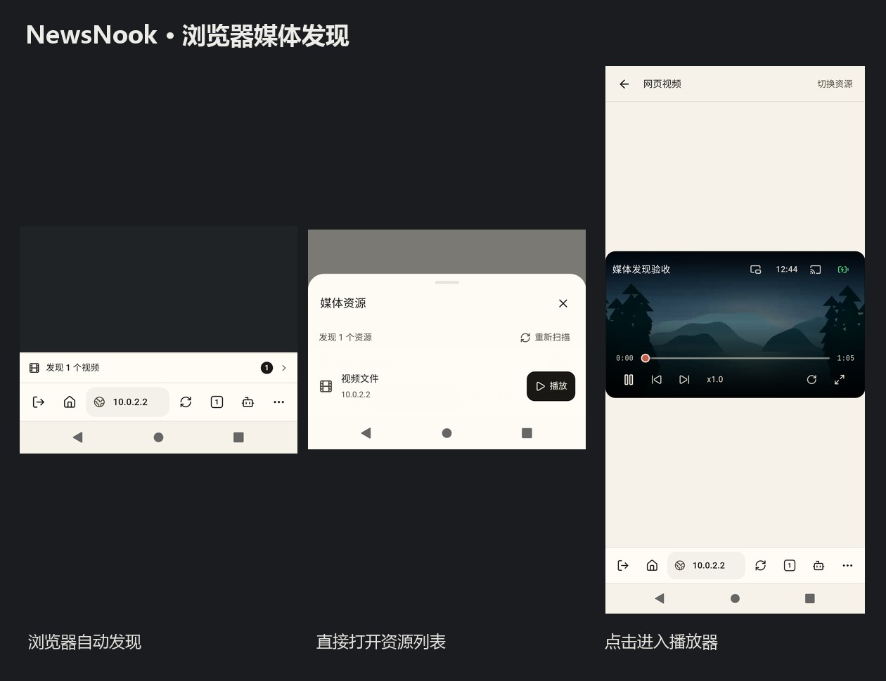
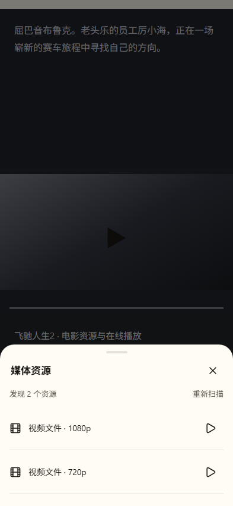
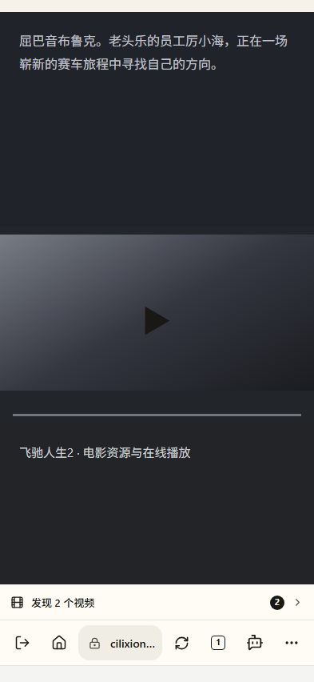

# NewsNook · 浏览器媒体发现入口

日期：2026-10-25 · 分支：`feat/browser-media-discovery`（基于 `origin/beta`：`4da821c`）

交付边界：**只提交特性分支，不合并 beta / master，不触发发版**。



## 设计选择

**北极星：用户在最熟悉的浏览器控件区域发现媒体，网页内容不被挡住。**

应用浏览器的媒体嗅探和播放管线已经完整：`BrowserHostPlugin` 通过 `mediaEvent` 报告资源，`useBrowserSession` 按标签页管理资源快照，`browserMediaResources` 过滤广告、DRM、无效 URL 并去重，浏览器 `media` 面板已经支持扫描和播放。本次**不改原生嗅探算法、播放器内核、请求鉴权或 Android 权限**。

由于原生网页在 Capacitor Web UI 上层，简单在 HTML 里放悬浮按钮不一定能盖住原生 WebView，而且可能遮挡网页内部视频控件。本次选择始终位于浏览器工具栏内的媒体发现入口：

- **≤479px 手机窄屏**：浏览器地址栏邻接一条高 44px 的轻量媒体操作行（电影图标、`发现 N 个视频`、数字角标、轻箭头），与上下地址栏位置自动对应；无媒体时不占空间。网站域名仍保持原有可读空间。
- **≥480px 宽屏**：媒体图标和计数直接出现在地址栏右侧，不额外占一整行。首次发现时，地址栏文字暂时显示 `发现 N 个视频`，约 2.5 秒后退回域名；网站信息和搜索入口始终仍可点击。
- **≤360px 极窄屏**：主页、AI 助手的快捷按钮自动隐藏，功能仍可从已有网页工具菜单进入；搜索网址、标签页、刷新、网页工具保持可操作。
- 入口使用应用主题语义色（非独立硬编码色板），至少 44px 的触控尺寸，并在 reduced-motion / EInk 关闭非必需动画。

## 用户行为与状态同步

点击入口直接打开**已有**媒体资源弹层并发起原生重新扫描，无额外重复面板。可以选择资源进入原播放器；播放器独立展示时，媒体发现入口临时隐藏，避免抢夺注意力。

入口只显示当前原生 tabId 与当前文档 URL 相匹配的**有效可播放资源**数量；URL hash 变化保留状态，但导航到另一文档立即隐藏旧入口。后台标签页的结果不会冒充当前页。资源归零或关闭页面时入口消失。隐私模式不影响本机内存嗅探，但首次发现提示与查看状态只存在于组件内存，不持久化视频 URL 或提示记录。

同一页面首次展示提示，已查看的页面不重复打扰；通过旧网页工具菜单打开媒体资源后也会视为已查看。

## 核心实现

- `src/features/browser/BrowserAddressBar.tsx` — 独立地址栏与 `BrowserMediaStrip`，页面身份核对，内存提示状态及键盘/触摸语义。
- `src/features/browser/BrowserWorkspace.tsx` — 按当前页面过滤可播放资源，复用原来的媒体列表、`scanMedia`、`InkVideoPlayer`；顶/底栏布局、极窄屏可达性。
- `src/features/browser/browser.css` — 主题配色、移动端轻量条、宽屏地址内角标、动效与响应式布局。
- `scripts/browser-workspace.test.tsx` — 真实 React 工作区模拟原生事件，覆盖发现→列表→播放、历史标签页、页面切换、防泄漏与隐私。
- `scripts/browser-media-discovery-visual.cjs` 和 `scripts/fixtures/browser-media-discovery/` — 独立 Chromium 视口取证与真实 MP4 的 Android QA 页面。

## 验收

### Android 原生

在独立 Android 12 (API 31)、WebView `91.0.4472.114` 模拟器使用临时 QA 构建、真实 `BrowserHostPlugin` 和本地 MP4：

1. 网页媒体加载后自动显示 `发现 1 个视频` 的工具栏入口。
2. 点击入口打开原有 `媒体资源` 弹层，显示有效资源 1 项。
3. 点击列表 `播放` 成功进入 NewsNook 播放器。

使用的是实际 Android 原生 WebView，而不是只截取模拟网页。首次 QA 入口曾跳过正式 `BrowserLauncher` 的 CSS 动态加载，改为在 QA 入口加载相同 CSS 后，实际渲染和点击链路通过；生产代码原有 CSS 加载路径未变。**临时 QA Bootstrap 和组件不会进入最终提交与正式构建。**

### Web UI 与交互

- 393×852 / 320×740 / 700×852：工具栏不横向溢出，媒体入口可点，宽屏图标不与刷新重叠。
- 地址栏顶置、底置、隐私状态、无媒体与资源数量 9+ 的界面覆盖。
- 原生事件模拟：独立标签页、跨页清理、同页 hash、首次提示、直达列表、播放器切换、私密数据不落盘。
- 每个控件使用现有主题 token、屏幕阅读器名称和焦点语义；无资源时不产生死按钮。

### 命令

```sh
node --experimental-test-module-mocks --import tsx scripts/browser-workspace.test.tsx
node --import tsx scripts/browser-media.test.ts
node scripts/browser-media-discovery-visual.cjs  # 需本地 Vite :5184
npx tsc -b --pretty false
npm run lint
npm run test:webview-css-compat
npm run build
```

视觉合辑可见 `docs/evidence/browser-media-discovery/android-proof.jpg`。本轮以真实浏览器和 Android 截图自检，未调用独立视觉评审员评分。

## 浏览器控件的第二轮视觉精修





- **媒体资源列表的「播放」**：最终进一步去除可见按钮边框、底色和文字，仅保留 20px/1.9 播放图标。44×44px 是透明触控命中范围，并非可见按钮外框；按下时使用主题底色反馈。资源名称成为列表视觉主角，播放操作仍可通过 aria-label 访问。
- **AI 浏览助手的工具栏图标**：从内部留白较多的 `Bot 20px/1.8` 换成 `BotMessageSquare 22px/1.9`，点击区域仍为 44×44px，菜单项与工具栏保持同一语义图标；原有任务角标与展开行为不受影响。
- **验收**：在 Chrome 393×852、320×740、700×852 的真实 React 组件界面验证；浅色主题播放按钮颜色 `rgb(26,24,21)`、表面 `rgba(26,24,21,.043)`、边框约 12% 透明度，44px 触控高度；深色主题同样使用语义 token。更新了浏览器工作区单测对按钮样式和 AI 图标尺寸的断言，连续三轮通过，类型、Lint、WebView CSS 兼容检查通过。此次是局部视觉精修，未额外执行 Android 原生设备重测或独立视觉评审。
