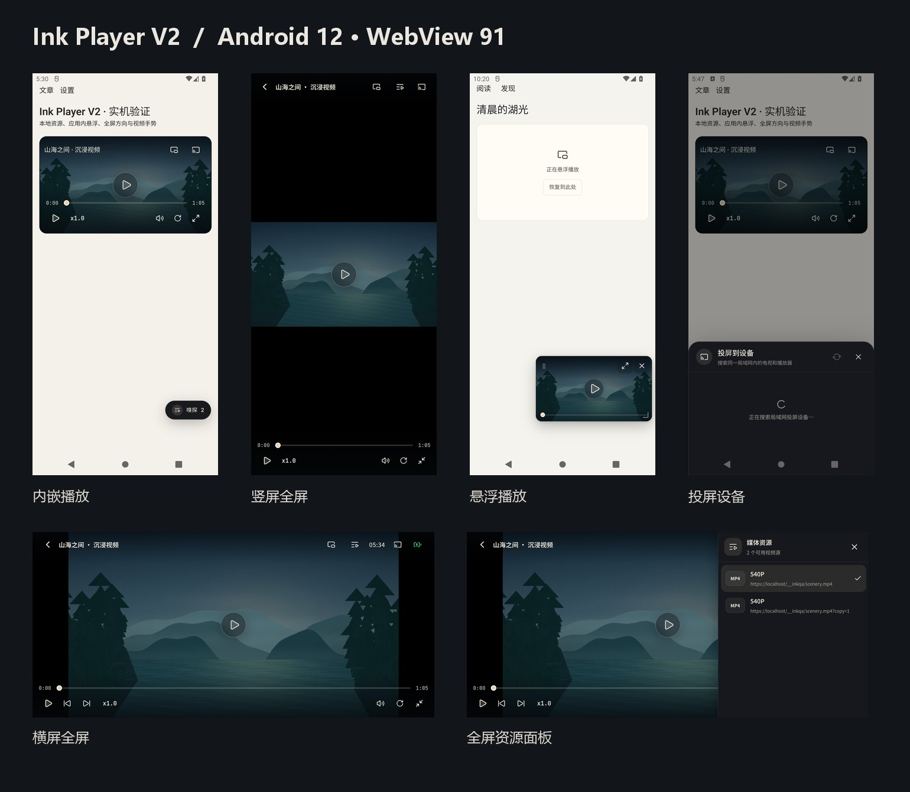
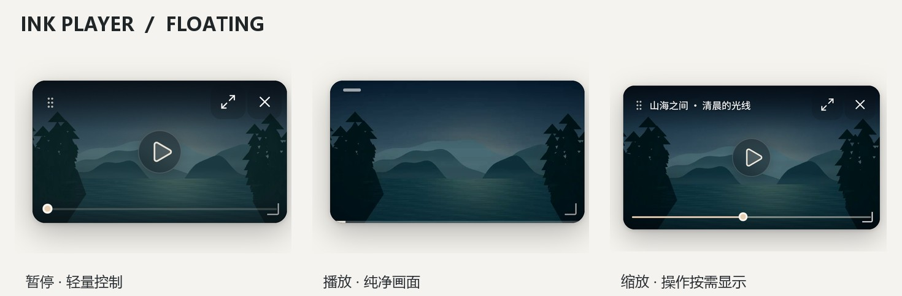
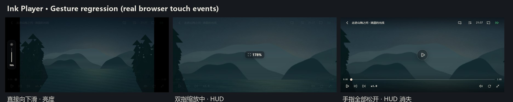

# Ink Player V2 — UI / 交互交付与验收

日期：2026-10-25。开发分支：`feat/ink-player-v2-ui`（由 `beta` 的 `4da821c` 创建）。**禁止自动合并到 beta / master，禁止自动发版。**



## 悬浮小窗精修（2026-10-25）



- **彻底删除独立标题栏**：窗口几何不再额外增加 44px；视频完整占据小窗并随实际视频宽高比调整，边缘仅保留极细层次阴影而非厚边框。
- **画面内浮动控件**：顶部只保留拖动热区、恢复与关闭；较宽窗口才显示截断标题。右下角保留 44px 不可见缩放触摸区域，但只画一组细角标。
- **不重复播放控件**：小窗里移除底部重复的播放/全屏按键排，只在中央显示按需播放/暂停，底部保留进度输入与播放时 2px 的被动进度线。点击播放器唤出控件；播放约 2.6 秒后自动退隐，暂停时保持可操作。
- **避免误触**：进度条的交互区域与右下角缩放热区在几何上互不重叠；首次使用提示改为短暂的画面内轻文本，不再出现大块黑色提示。
- **能力完整保留**：应用内移动、拖拽缩放、双指缩放、跨页播放、恢复独立播放页与关闭均沿用原有会话；需全屏时在恢复播放页后进入原有横/竖屏全屏。

验收：Android 12 / WebView 91 隔离模拟器实际截屏并执行播放、暂停、拖动和缩放；Chromium 393×852 视口检查纯 16:9 画面、UI 隐藏、细进度条、两个角落操作及缩放热区与进度不交叠。`npm run test:floating-video` 的生命周期、几何、键盘与手势用例已随新结构更新。独立视觉评审未派发，以上为基于实际截图的自检。

## 设计北极星

**视频是主角；只有需要操作时，控件才进入视线。** 延续 NewsNook 沉浸、克制的工具感和主题语义色。播放器始终使用暗色场景，但亮度、文字色和强调色由应用 `--tone-*` 语义变量提供，不从外部主题硬编码随机色板。

不采用完整画面的透明磨砂面板或调音量时整屏压暗；仅上下控制区使用有限的渐变，触控反馈与视频画面解耦。

## 展示模式与功能

| 场景 | 行为与验收点 |
| --- | --- |
| 正文内嵌 | 独立 poster / 视频画面；点击播放 / 暂停、进度、倍速、静音、投屏、悬浮、全屏 |
| 横屏全屏 | 原生 Android 隐藏系统栏；标题 / 时间 / 电量 / 投屏 / 媒体资源和底部控制区适配横向安全区 |
| 竖屏全屏 | 完整保留画面比例，居中 letterbox；上下控制按安全区布局，紧凑态保留核心功能 |
| 屏幕方向 | 锁横屏、跟随设备、锁竖屏三级菜单；无原生方向锁时使用既有 CSS 旋转兜底 |
| 手势 | 右半屏音量、左半屏亮度、横滑快进/快退；顶部轻量进度提示、边缘音量/亮度条，不叠整屏黑色遮罩 |
| 交互加速 | 双击区域操作、长按加速、缩放与平移、播放速率选择（沿用播放器逻辑） |
| 应用内小窗 | 持久视频会话；拖动、右下角缩放、双指缩放、跨页面、恢复、关闭；播放器不会因移出母页而重建 |
| 独立播放页 | 原视频实例、原播放位置；标题只在页头展示，媒体资源收进播放器顶部工具栏，避免悬浮资源按钮遮挡内容 |
| 媒体资源 | 全屏内与独立页内使用舞台内抽屉；切换资源仅重新初始化媒体解码，不重建播放器组件或退出全屏 |
| 投屏 | 沿用现有 Android DLNA 设备发现、直连/中转、遥控、错误与结束逻辑；弹窗沿用主题变量并验证深色可读性 |
| 异常与边界 | 缓冲、重试、鉴权、直播、HLS/DASH、返回键与生命周期保持现有行为，专项测试覆盖 |

### 明确保留的产品边界

- **悬浮播放是应用内小窗**，不是 Android 系统级 PiP 或跨应用覆盖层；无需新增系统悬浮窗权限。
- 安卓端 DLNA 的真实电视端播放性能与厂商兼容性依赖可用的局域网投屏设备；本次在模拟器完成投屏搜索 / 弹层 UI 验证，真实设备的连通与遥控沿用既有投屏测试。
- 正常播放不会为了界面模式切换创建第二个 `video`、HLS 或 DASH 实例。
- 不增加生产依赖、云端服务或播放器状态库。

## 实现与测试入口

关键实现：
- `src/components/InkVideoPlayer.tsx`：播放器状态、手势、模式切换、源保持。
- `src/components/inkVideoPlayer/GestureHudOverlay.tsx`：贴边音量/亮度、时间与缩放反馈。
- `src/components/inkVideoPlayer/PlayerSourceSheet.tsx`：真正嵌入视频舞台的资源抽屉，支持 DOM Fullscreen。
- `src/components/inkVideoPlayer/PlayerRotationMenu.tsx`：屏幕方向菜单。
- `src/features/floatingVideo/*`：持久会话与小窗；保持原架构。
- `src/styles/player/*`：主题一致的播放器控件、响应式、旧 WebView 兼容。

回归命令：

```sh
npm run test:ink-player-v2
npm run test:video-player
npm run test:native-fullscreen
npm run test:webview-css-compat
npm run test:webview-runtime-compat
npm run lint
npx tsc -b --pretty false
npm run build
```

浏览器视觉测试使用受控本地 MP4，避免外部网络和版权素材波动：

```sh
npx vite --host 127.0.0.1 --port 5179
npm run test:ink-player-v2-visual
```

截图取证路径：被 `.gitignore` 排除的 `evidence/ink-player-v2/`（本地），用于分支审阅的实际设备截图合辑为 `docs/evidence/ink-player-v2/overview.jpg`。

## 自动化回归与构建结果

- `npm run test:video-player`：完整播放器聚合测试通过，包括媒体恢复、悬浮会话、投屏、嗅探、Range、代理、方向与手势。
- `npm run test:ink-player-v2`、`npm run test:floating-video`、`npm run test:ink-video-live-updates`：上述关键异步测试各执行三轮，均通过；实时媒体更新共 25 个用例。
- `npm run lint`、`npx tsc -b --pretty false`、`npm run test:webview-css-compat`、`npm run test:webview-runtime-compat`、`npm run test:hardware-back`：均通过；Lint 仅报告仓库已有警告。
- `npm run build`、`npx cap copy android`、`:app:assembleCloudDebug`、`:app:assembleLocalDebug`：均通过。cloud / local 双变体可编译；构建仅包含正式 NewsNook，移除临时 QA 入口后已确认 `dist` 和 Android 资源目录没有 `__inkqa` 文件。
- 桌面 Chromium DevTools 自动截图：393×852、844×390 和 1180×850，内嵌、横竖屏全屏、全屏资源抽屉、悬浮小窗、独立播放页；没有横向溢出，资源按钮按模式正确切换。
- 原生 Android 12、WebView 91 的设备验收使用隔离 AVD，详见下文。测试截图采用真实播放器与真实 MP4 视频；没有用独立模拟 UI 代替生产组件。

## 已运行的设备验收（Android 12 / WebView 91）

独立的 `InkPlayerV2` AVD（Android 12 / API 31、WebView 91.0.4472.114）中安装了临时 QA APK，内嵌同一套正式播放器组件和原生插件，使用本地可播放 MP4：

- 正文播放控件在旧 WebView 正常显示；原生横屏全屏和竖屏全屏能够切换，画面比例与进度保持。
- 全屏内资源抽屉可打开、可选视频源，选择后仍处于全屏。
- 音量竖滑与进度横滑确实触发边缘 / 顶部轻量 HUD，不出现全屏压暗。
- 全屏进入应用小窗、文章页面卸载后跨页保留、小窗拖动和缩放、恢复到独立播放页均成功。
- 投屏搜索弹窗能打开，发现并修复了 Portal 下主题变量未继承导致的标题对比度问题，重新构建安装后实际画面验证通过。

**验收边界**：没有连接真实 DLNA 电视完成电视端起播；物理返回键测试的临时 QA Shell 不包含主 `App.tsx` 的全局 backButton 注册，不能用该 Shell 的结果推断生产版返回键表现。正式应用沿用全局返回事件处理，回归测试覆盖硬件返回栈与播放器生命周期。

临时 QA 页面（`src/__InkPlayerQa.tsx`、`public/__inkqa/`）只为设备验证，**已从最终分支源码移除**。最终可交付 APK 是清理后重新构建的普通 NewsNook，不包含测试入口。

## 视觉与交互评审

保留一个视觉主角：视频画面。减少重复标题、无意义透明面板以及固定在页面边缘的多余功能入口。控制层仅在主动唤出或暂停时出现；触控 / 菜单状态保留反馈，不让加载遮罩盖住正在拖动的画面。

动效包括：控制栏淡入淡出、时间轴拖动响应、控件触碰缩放；开启系统「减少动态效果」时关闭非必需过渡。已进行人工截图自检；本分支未由独立视觉评审者打分。

## 手势状态机根因修复（2026-10-25）



本轮是 **播放器事件状态修复**，不是调整 HUD 的透明度或动画：

1. **双指 HUD 不消失**：旧代码在第一根手指抬起时就清空 `multiTouchRef`；随后第二根手指抬起被误归类为普通单指结束，未执行 `fadeHud()`。现在多指事务一直保持到最后一个 pointerup，才统一恢复控件并启动 HUD 淡出。
2. **取消事件遗漏**：Android `pointercancel` / 意外失去 `pointercapture` 时，旧代码只处理已经锁定进度/音量轴的 HUD，双指缩放的 `axis: none` 不会淡出。现在取消事件始终清理全部指针、释放所有捕获、重置多指/长按/亮度状态并淡出 HUD；延迟到来的终止事件被忽略。
3. **原生异步写入竞态**：亮度/音量桥接写入结束可能晚于第二根手指按下，旧回调通过 `showHud` 把新缩放 HUD 覆盖、并重置旧定时器。现在用单调递增的手势 epoch 标记原生写入，只有当前事务才允许更新 HUD；触摸未结束时，过期请求也不再启动干扰性淡出。
4. **缩放后长按失效**：旧代码以 `videoView.scale === 1` 为启动长按计时器的条件。现在取消该条件，长按可在放大画面上触发，移动超过触控阈值及出现第二根手指仍会取消加速，松手恢复用户原有倍速。
5. **第一次向下滑不响应**：亮度/音量以前只在视频下半屏开始滑动时接受手势；从上半屏直接下滑无法锁定。现在全屏左/右半屏的竖向滑动均可直接启动亮度/音量调节，横向进度调整仍限定原下半屏区域，避免误触。

### 回归证据

- `scripts/ink-player-gesture-regression.test.tsx`：通过真实 React PointerEvent 分发覆盖首次向下、双指依次抬起、缩放后长按加速、pointercancel、lostpointercapture、意外残留终止事件，以及 HUD 过期收尾。
- `scripts/ink-player-native-gesture-regression.test.tsx`：通过可控延迟原生媒体控制桥验证“亮度写入仍在进行 → 第二指加入 → 缩放 HUD 显示 → 迟到的写入返回 → HUD 不被覆盖 → 最后一指松开后清除”。
- `scripts/ink-player-v2-visual.cjs`：Chromium DevTools 真实 `Input.dispatchTouchEvent`，844×390 横屏全屏中先向下调亮度/音量、双指缩放、按顺序松开两个指头，验证 HUD 都自动消失。
- `npm run test:ink-player-v2`：关键回归连续三轮通过；`npm run test:video-player`：完整播放器聚合测试通过；类型检查、Lint 和 WebView 兼容检查通过。

**Android 验证范围**：在独立 Android 12 / WebView 91 模拟器中已编译安装临时 QA APK、显示全屏播放器；模拟器发生 System UI ANR，且该设备的 WebView 远程调试接口无法实际注入触摸事件，因此不能将这次 Android 多指注入记作通过。生产逻辑在真实 Chromium PointerEvent 和原生桥异步模拟环境下完成验收。未使用连接的个人手机；临时 QA 页面已从正式源码删除。

代码只在 `feat/ink-player-v2-ui` 开发与提交，不合并 `beta`、不发版。
